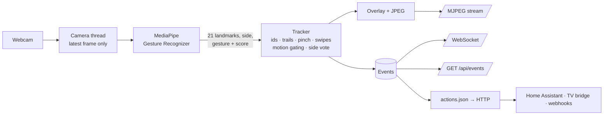

# gestura

Turn a webcam into a stream of clean hand-gesture events — with live hand tracking in the browser and HTTP actions per gesture.

Show a thumbs-up and your lights get brighter; swipe right and the next track plays. gestura handles the hard part — camera, model, tracking, false positives — and hands every consumer (Home Assistant, a TV bridge, your own service) a small, debounced event like `{"type": "gesture", "name": "Thumb_Up", "hand": "Right"}`.

Everything runs locally. No video, frames or landmarks ever leave the machine.

## Features

- **Hand gestures**: 7 static gestures from Google MediaPipe, plus pinch, four-way swipes, and a hand entering or leaving the frame.
- **Tracking**: up to two hands. Each one keeps its id and color while it's in frame, with a palm trail, speed, and a left/right side decided by vote over the hand's lifetime.
- **Few false positives**:
  - a gesture fires once, after a still hand holds it for 5 frames;
  - while the hand moves fast, static gestures are suppressed, because blurred frames make the model confidently wrong;
  - swipes have a cooldown and are ignored right after a hand enters the frame.
- **Live web UI**: annotated video, a card per hand, an event feed with action results, and switchable overlay layers.
- **HTTP actions**: map any event to any HTTP request in a JSON file, with secrets taken from environment variables.
- **Event API**: cursor-based polling for consumers without inbound ports, and a WebSocket for live state.

## How it works



The model is [MediaPipe Gesture Recognizer](https://ai.google.dev/edge/mediapipe/solutions/vision/gesture_recognizer) (float16, ~8 MB, Apache 2.0). It bundles three networks: a palm detector, a 21-point hand landmark model, and a gesture classifier. It runs on the CPU via TensorFlow Lite, at about 17 ms per frame on a laptop. Pinch, swipes, tracking, and all the debouncing are rules in [`tracker.py`](src/gestura/tracker.py), not part of the model.

## Gestures

| Event | Gesture |
|---|---|
| `Open_Palm` 🖐 · `Closed_Fist` ✊ · `Pointing_Up` ☝️ | static, from the model |
| `Thumb_Up` 👍 · `Thumb_Down` 👎 · `Victory` ✌️ · `ILoveYou` 🤟 | static, from the model |
| `Pinch` 🤏 | thumb and index tips together |
| `swipe_left` · `swipe_right` · `swipe_up` · `swipe_down` | palm travels ~⅓ of the frame height in ~0.35 s |
| `hand_enter` · `hand_leave` | a hand appears or disappears |

Directions are as you see yourself in the mirrored picture: moving your hand to *your* right is `swipe_right`.

## Quick start

Requirements: Python 3.11+ and a webcam. Developed and tested on Windows 11. Linux and macOS should work, since the platform-specific parts are guarded, but they haven't been tested.

```bash
git clone https://github.com/alim-tg/gestura.git
cd gestura
uv venv .venv --python 3.12
uv pip install --python .venv/Scripts/python.exe -e .   # Linux/macOS: .venv/bin/python
.venv/Scripts/gestura serve                              # Linux/macOS: .venv/bin/gestura serve
```

Open http://127.0.0.1:8800 and show your hand to the camera.

On first run gestura downloads `gesture_recognizer.task` (~8 MB) from `storage.googleapis.com` into `models/`. You can also download it ahead of time with `gestura model`.

Plain `pip` works too: `python -m venv .venv && .venv/Scripts/pip install -e .`

### Options

```
gestura serve [--camera 0] [--width 1280] [--height 720] [--hands 2]
              [--no-mirror] [--host 127.0.0.1] [--port 8800]
gestura model
```

| Option | Default | |
|---|---|---|
| `--camera` | `0` | camera index |
| `--width`, `--height` | `1280×720` | requested capture size |
| `--hands` | `2` | max hands tracked |
| `--no-mirror` | off | show the raw, non-mirrored view (for rear-facing cameras) |
| `--host` | `127.0.0.1` | use `0.0.0.0` to expose on your LAN. There is no auth, see [Limitations](#limitations) |
| `--port` | `8800` | |

## Actions: gestures → HTTP

Copy the example and set the variables it references:

```bash
cp actions.example.json actions.json        # actions.json is git-ignored
export HA_TOKEN="your Home Assistant long-lived token"   # PowerShell: $env:HA_TOKEN = "..."
gestura serve
```

Keys are event names, and values describe the request:

```json
{
  "Thumb_Up": {
    "url": "http://homeassistant.local:8123/api/services/light/turn_on",
    "headers": { "Authorization": "Bearer ${HA_TOKEN}" },
    "json": { "entity_id": "light.room", "brightness_step_pct": 20 }
  },
  "swipe_right": { "url": "http://127.0.0.1:9000/gesture" }
}
```

| Field | Default | |
|---|---|---|
| `url` | required | `${VAR}` is expanded from the environment |
| `method` | `POST` | |
| `headers` | none | values expanded from the environment |
| `json` | the event itself | omit it to forward the event as the body |
| `timeout` | `3` | seconds |

Requests run in a background pool, so a slow or dead host never stalls the video. Each result appears in the feed as `⚡ Thumb_Up → 200` or `error: ConnectTimeout`. The file is read at startup.

Controlling a TV works the same way. Home Assistant has integrations for Samsung, LG, Android TV and others (`media_player.volume_up`, `media_player.media_play_pause`, `remote.send_command`), so the TV becomes just another action target.

## Consuming events

**Poll by cursor.** Suits consumers that keep no inbound ports:

```bash
curl "http://127.0.0.1:8800/api/events?after=0"
```

```json
[{"id": 57, "type": "gesture", "name": "Thumb_Up", "track": 3, "hand": "Right", "ts": 1760781234.12}]
```

Keep the last `id` you saw and pass it as `after` next time. Types are `gesture`, `swipe`, `enter`, `leave` and `action`, and names come from the closed set above.

**Live stream.** `ws://127.0.0.1:8800/ws` pushes `{state, events}` about 15 times a second: hands with position, speed and gesture, fps, camera status, and new events.

| Endpoint | |
|---|---|
| `GET /` | web UI |
| `GET /stream.mjpg` | annotated video (MJPEG) |
| `GET /api/state` | current snapshot |
| `GET /api/events?after=ID` | events newer than `ID` (last 300 kept) |
| `POST /api/overlay` | `{"landmarks": bool, "trails": bool, "boxes": bool}` |
| `WS /ws` | state + new events, ~15 Hz |

> A gesture is an unauthenticated trigger: gestura does not know *whose* hand it sees. It's fine for reversible actions like volume, lights or pause, but not as the sole confirmation for anything that matters.

## Tuning

All thresholds live in [`config.py`](src/gestura/config.py):

| Setting | Default | Effect |
|---|---|---|
| `hold_frames` | `5` | still frames a gesture must hold before it fires |
| `still_speed` | `1.0` | frame heights/s above which a hand counts as moving and static gestures are suppressed. Raise it if gestures feel sluggish, lower it if waving still triggers them |
| `min_score` | `0.6` | minimum model confidence |
| `pinch_ratio` | `0.28` | thumb–index distance relative to hand size |
| `swipe_distance` / `swipe_window` / `swipe_cooldown` | `0.3` / `0.35 s` / `0.8 s` | swipe sensitivity |
| `track_distance` / `track_ttl` | `0.35` / `0.5 s` | how far a hand may jump between frames and still keep its id, and how long a lost hand is remembered |

## Performance notes

- **Windows power throttling.** A windowless process that idles between frames gets throttled by Windows (EcoQoS), and inference drops from ~17 ms to ~110 ms per frame. `gestura serve` opts out automatically ([`power.py`](src/gestura/power.py)).
- **Camera fps.** The UI shows two rates: processing and camera. If they match, the camera is the bottleneck. Integrated webcams drop to ~20 fps in dim light. On DirectShow, gestura requests MJPG last, because setting the resolution or fps afterwards silently falls back to uncompressed YUY2 at ~10 fps.

## Limitations

- **No authentication.** That's fine on `127.0.0.1`. With `--host 0.0.0.0`, anyone on the network can watch the camera.
- **Event ids reset on restart** (in-memory counter). A polling consumer can't yet tell a restart from silence.
- **Distance.** Small hands far away (a sofa 3 m from a 720p camera) are detected unreliably.
- **No activation gesture yet.** In front of a TV, people gesticulate, so expect occasional false triggers.
- **Fixed gesture set.** Custom gestures need a retrained classifier (MediaPipe Model Maker) or a small classifier over the 21 landmarks.
- **One camera, at most two hands.** Only discrete events, no continuous controls like pinch-and-drag volume.

## Project layout

```
src/gestura/
  cli.py         gestura serve / gestura model
  server.py      FastAPI: UI, MJPEG, WebSocket, REST
  engine.py      processing thread: recognizer → tracker → overlay → events
  camera.py      capture thread, keeps only the latest frame
  recognizer.py  MediaPipe Gesture Recognizer wrapper, handedness fix
  tracker.py     ids, trails, pinch, swipes, motion gating, side vote
  overlay.py     skeleton, boxes, trails, banner
  actions.py     actions.json → HTTP
  power.py       Windows power-throttling opt-out
  web/           vanilla JS UI
spec/
  spec.md          behavior, consumers, acceptance criteria, what it does not do
  architecture.md  modules, threads, API, event format
  gestures.md      recognition, stabilization, tracking, swipe rules
```

The spec in [`spec/`](spec/) is the source of truth for behavior.
